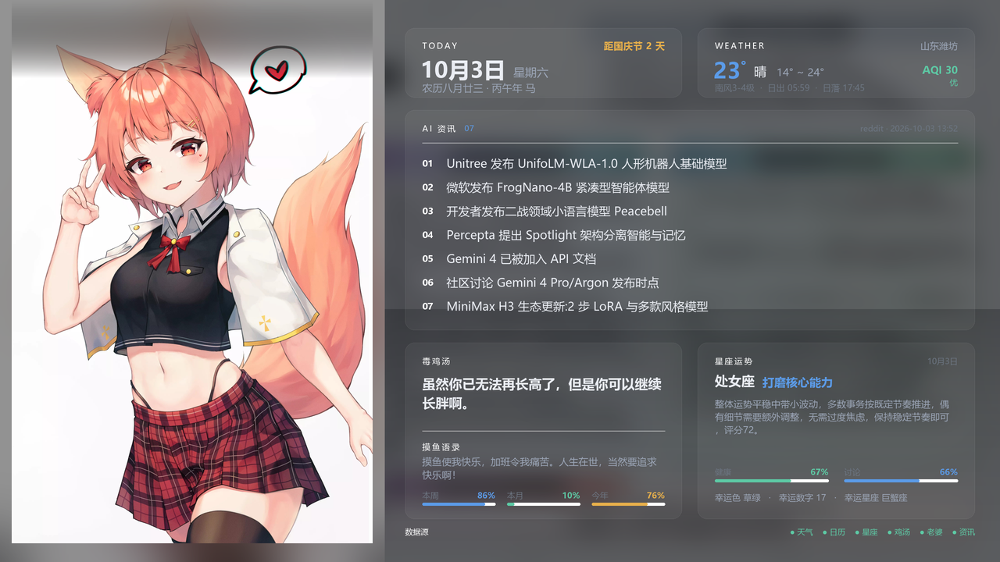

# daily-wallpaper

> 把 AI 资讯、天气、农历、星座运势、摸鱼日报聚合渲染成一张 2560×1440 的桌面仪表盘，每天自动更新。

一个用 Python + Pillow 生成的**信息型桌面壁纸**。不是随机风景图，而是一屏可读的每日概览：左边一张人物立绘，右边五块信息卡片。

同时提供一份 **Lively Wallpaper 动态壁纸**：页面每 30 分钟实时拉取接口，信息可滚动、卡片可展开，适合常开机的机器。

---

## 特性

- **6 路数据源聚合** —— AI 全网资讯 / 天气 / 农历节气 / 星座运势 / 摸鱼日报 / 毒鸡汤
- **三级降级链，接口挂掉也不断图** —— 实时接口 → 上次成功响应缓存 → 本地算法推算
- **农历与节气自力更生** —— 1900–2100 农历换算 + 寿星公式节气，全部本地实现，不依赖第三方库
- **零重依赖** —— 抓取只用标准库 `urllib`，渲染只用 Pillow；不装 requests，不启浏览器
- **双轨交付** —— 静态 PNG（锁屏 / 幻灯片）+ Lively HTML（实时刷新）
- **每日自动更新** —— 一行命令跑完全流水线，可挂 Windows 计划任务或 WorkBuddy 自动化
- **数据源健康指示** —— 图上直接标出每一路是「实时 / 缓存 / 本地 / 失败」，出问题一眼可见
- **全参数可调** —— 城市、星座、分辨率、配色、接口、实例列表都在 `config.json`

## 预览

<!-- 建议放一张 output/today.png 的截图，这里用相对路径 -->


## 快速开始

```bash
git clone https://github.com/<你的用户名>/daily-wallpaper.git
cd daily-wallpaper

# 建虚拟环境并安装依赖（只有一个包）
python -m venv .venv
.venv\Scripts\python.exe -m pip install pillow      # Windows
# source .venv/bin/activate && pip install pillow   # Linux / macOS

# 跑一遍
.venv\Scripts\python.exe main.py
```

生成的图在 `output/today.png`，同时会归档一份 `output/wallpaper_YYYY-MM-DD.png`。

**改配置**：编辑 `config.json` 里的 `city`（默认潍坊）、`zodiac`（默认处女）、配色等，详见下方「常用调整」。

**可选参数**：

```bash
python main.py --no-wallpaper   # 不修改当前桌面壁纸
python main.py --no-lively      # 不烘焙 Lively 数据
```

## 设计说明

### 版式（2560×1440）

```
┌─────────────┬─────────────────────────────────────────────┐
│             │  TODAY 9月29日  |  WEATHER 潍坊 21° 晴       │ ← 顶部信息条
│  今日老婆    │  农历八月十九    |  AQI 65 良 · 日出/日落     │
│  立绘        ├─────────────────────────────────────────────┤
│  985×1392   │  AI 资讯 07                                  │
│  按高度铺满   │  01 … 02 … 03 … 04 … 05 … 06 … 07 …         │ ← 资讯区
│  ★无任何遮罩  ├────────────────────┬────────────────────────┤
│  ★不裁切     │  毒鸡汤（大字）      │  星座运势               │
│  ★不压暗     │  摸鱼语录           │  幸运色/数字/星座        │
│             │  本周/本月/今年      │  健康/讨论 指数          │ ← 底部双卡
├─────────────┴────────────────────┴────────────────────────┤
│  数据源                         ● 天气 ● 日历 ● 星座 …      │ ← y=1362
└───────────────────────────────────────────────────────────┘
   ↑ 内容到此为止，y=1392 以下是 48px 任务栏（壁纸永远被它盖住）
```

### 三条硬约束

**1. 任务栏安全区。** Windows 壁纸永远会被任务栏盖住屏幕底部。本机实测任务栏 48px，所以 `SAFE_BOTTOM = 1440 − 48 = 1392`，**所有内容必须落在 y < 1392 之内**。第一版没考虑这点，把数据源健康指示画在 y=1408，结果整行 100% 藏在任务栏底下，等于白做。换分辨率或改任务栏高度后，`render.py` 顶部的 `TASKBAR` 常量要同步改。

**2. 立绘不裁切。** 人物立绘是 849×1200（比例 0.71）的竖图。要填满一个 780×1440（比例 0.54）的窄条，用 `cover` 就必须横向切掉约 40%，人物的手和头发会被切在框外。**改成让列宽去适配图片，而不是让图片去适配列宽**：按高度贴合（`scale = SAFE_BOTTOM / 图高`）得到 985×1392，列宽就取 985。

**3. 主角图不叠遮罩。** 立绘是画面的主角，不给它加渐隐、压暗、模糊或任何滤镜。曾经在右半边叠过 42% 宽的渐隐、整体压过亮度，效果就是人物被"糊掉"了一半。现在铺满时**零遮罩直接合成**；只有某天的图比例不同、贴不满整列时，才在缺口处补一段同源模糊衬底（用前景边缘向上/向两侧扩展 = edge clamp）并做渐显，避免生硬截断。

> 衬底有个坑：**不能另做一次 `cover` 放大当衬底**——那样同一张图会有两个尺度，接缝非常明显。

### 视觉语言

- **轻玻璃面板**：极淡的白色叠加（alpha 12）+ 一道 1px 亮边（alpha 30），而非实色块
- **小标题用大字距低对比**（21px + 4px 字距 + alpha 120），替代粗体大标题——这是"轻盈"的主要手段
- **背景用资讯配图**，高斯模糊 30px + 压暗到 168/255，下方再叠一层渐变暗纱保证底部文字对比度
- **毒鸡汤自适应字号**：34 → 31 → 28，自动挑一个能落在 2 行内的字号

## 数据源

| 内容 | 接口 | 说明 |
|---|---|---|
| AI 全网最新资讯 | `api.pearapi.ai/api/latest_ai_consultative` | 返回配图 + 10~20 条带摘要的资讯 |
| 今日老婆 | `api.pearapi.ai/api/today_wife?id=YYYYMMDD` | 849×1200 竖图，`id` 传当天日期 |
| 毒鸡汤 | `api.pearapi.ai/api/dujitang` | 纯文本，一句话 |
| 星座运势 | `api.pearapi.ai/api/xzys/?xz=处女` | GET / POST 都行，含 4 段长文 |
| 摸鱼日报 + 农历 | `60s` 公共实例 `/v2/moyu` | **内部已含完整农历**，另有进度与假期倒计时 |
| 潍坊天气 | `60s` 公共实例 `/v2/weather/forecast?query=潍坊` | 腾讯天气源，中文描述 + AQI + 日出日落 |

**几点实测结论**（2026-09 验证）：

- `60s.viki.moe` 主域名托管在 Deno Deploy，部分地区被墙。方案是配 **8 个公共实例自动故障转移**，见 `config.json` 的 `sixty_s.instances`。官方列表：<https://docs.60s-api.viki.moe/7306811m0>
- 官方 `/v2/lunar` 接口标注「开发中」且不稳定，**已弃用**——`/v2/moyu` 已给出完整农历信息，省一个请求。
- 天气不用 wttr.in（数据粗）也不用 open-meteo（WMO 编码要自己映射中文），直接用 60s 的腾讯天气源。open-meteo 保留作兜底。

### 降级链

每一路数据都是三级降级，**任何接口挂掉都不会中断出图**：

```
实时接口  →  上次成功的响应缓存（cache/raw/）  →  本地计算（localinfo.py）
```

`localinfo.py` 能独立算出农历、节气、干支、生肖、周/月/年进度、周末与节假日倒计时，输出结构与 60s 摸鱼接口**逐字段一致**（已用 2026-02-17 春节、2026-09-25 中秋、2023 闰二月等 10 个已知日期校验通过；节气用寿星公式对 2026 全年 12 个节气校验通过）。

## Lively 动态壁纸

1. 打开 Lively Wallpaper → 「添加壁纸」→ 选择 `lively/LivelyInfo.json`
2. 页面每 30 分钟自动重新拉取所有接口
3. 断网时回退到 `data.js` 里烘焙的上一次快照，不会白屏

页面直接 `fetch` 这些接口 —— 已确认 pearapi 和 60s 实例都返回 `Access-Control-Allow-Origin: *`，跨域没问题。

## 每日自动更新

**方式一：Windows 计划任务**

双击 `install_task.bat` 即可（默认每天 06:00，不需要管理员权限）。卸载传 `-Remove`：

```
install_task.bat -Remove
```

**方式二：WorkBuddy 定时自动化**

如果你用 WorkBuddy，直接建一个每天定时跑 `main.py` 的自动化即可。

> 两种方式**只保留一种**，避免同一天重复生成。

## 目录结构

```
daily-wallpaper/
├── config.json          全部可调参数（城市、星座、分辨率、配色、接口、实例列表）
├── main.py              流水线入口：抓取 → 渲染 → 烘焙 Lively → 下发壁纸 → 清理
├── fetch_data.py        6 路数据抓取 + 故障转移 + 缓存降级
├── render.py            Pillow 渲染（顶部含 TASKBAR / PORTRAIT_W 等骨架常量）
├── build_lively.py      生成 Lively 动态壁纸的数据快照
├── localinfo.py         农历/节气/进度/倒计时的纯本地计算（断网兜底）
├── lunar.py             1900-2100 农历换算 + 寿星公式节气
├── run_daily.bat        给计划任务调用的批处理
├── install_task.bat/.ps1  计划任务安装脚本
├── set_wallpaper.ps1    把生成的图设为桌面壁纸
├── output/              生成产物（已 gitignore）
├── lively/              Lively Web 壁纸
│   ├── index.html
│   └── LivelyInfo.json
├── cache/               原始响应缓存 + 图片缓存（已 gitignore）
└── logs/fetch.log       运行日志
```

## 常用调整

改 `config.json`：

| 想改什么 | 改哪里 |
|---|---|
| 城市（当前潍坊） | `city`；若 60s 天气查不到，同步改 `fallback_weather.latitude/longitude` |
| 星座（当前处女） | `zodiac`，取值如 `白羊` `金牛` `处女` `天秤` |
| 今日老婆是否按日期变 | `wife_id_mode`，`today` = 每天不同 |
| 资讯条数（当前 7 条） | `ai_news_count`，建议 ≤ 8，再多会溢出资讯面板 |
| 配色 | `theme` 下的色值 |
| 面板通透度 | `theme.panel_alpha`（越小越透，当前 12）/ `panel_border_alpha`（当前 30） |
| 背景模糊/压暗程度 | `theme.bg_blur` / `theme.bg_dim`（0~255，越大越暗） |
| 任务栏高度 | **`render.py` 顶部的 `TASKBAR`**（不在 config 里，当前 48） |
| 立绘列宽度 | `render.py` 顶部的 `PORTRAIT_W`（当前 985） |
| 是否自动设壁纸 / 填充模式 | `output.set_wallpaper` / `output.wallpaper_style` |
| 留档天数 | `output.keep_days`（默认 14 天） |

> 分辨率、任务栏高度、立绘列宽度是**版式骨架常量**，改一个要连带检查其它，因为卡片坐标按这些值硬编码。改完务必渲染一次并检查底部有没有被任务栏吃掉。

## 排查

| 现象 | 处理 |
|---|---|
| 内容被任务栏挡住 | 有元素越过了 `SAFE_BOTTOM`（= 1440 − `TASKBAR`）；或任务栏设成"小图标"/自动隐藏导致实际高度变了 |
| 立绘被切掉手脚 | 用的是 `cover`。应让列宽适配图片：`scale = SAFE_BOTTOM / 图高` |
| 立绘上有渐隐/发灰 | 不该有。铺满时必须零遮罩直接合成 |
| 图片右下角出现 `○` | 看 `logs/fetch.log` 定位是哪一路；60s 相关先换实例 |
| 60s 全部实例失效 | 去官方文档拿新列表，填进 `config.json` 的 `sixty_s.instances` |
| AI 资讯面板空白 | pearapi 偶发超时，重跑一次即可 |

## 环境要求

- **Python 3.9+**（在 3.13 上开发验证）
- **Pillow**（唯一依赖）
- **中文字体**：自动探测，Windows 用微软雅黑，Linux 找 Noto Sans CJK / 文泉驿，macOS 找苹方
  - 都找不到时改 `render.py` 顶部的 `FONT_R` / `FONT_B` 指向本机字体
- 抓取不依赖 requests，渲染不依赖浏览器

### 已知的平台限制

这套代码在 Windows 上开发。迁到 Linux/macOS 只需处理 `set_wallpaper.ps1`（Windows 专用，换桌面壁纸那步），其余逻辑跨平台可用。

## 踩过的坑

开发过程中确认过的几个坑，避免你重复踩：

1. **`.bat` 必须「纯 ASCII + CRLF 换行」**。若同时满足「LF-only 换行」和「文件含多字节字符」，cmd.exe 的批处理读取器会丢失字节对齐，把 `rem` 注释行和下一行**合并成一条命令**执行；如果被合并的下一行正好是 `chcp 65001`，那 `chcp` 就永远不会生效 → 控制台停在 936 而脚本输出 UTF-8 → 满屏乱码。典型报错：`'鐢?E:\...\' 不是内部或外部命令`。修法：改 CRLF **或**去掉多字节字符，任一即可。
2. **`.ps1` 在 Windows PowerShell 5.1 下必须保持纯 ASCII**。PS 5.1 会把无 BOM 的 `.ps1` 按 GBK 解码，中文注释变乱码导致 `UnexpectedToken` 解析失败。需要写中文就另存为 UTF-8 with BOM。
3. **`pythonw.exe` 下 `sys.stdout is None`**，`print()` 会抛异常导致定时任务静默失败。`main.py` 和 `fetch_data.py` 开头都做了兜底。
4. **无头浏览器截图不可靠**。本机 Chrome/Edge 在 `--headless` 下静默退出（退出码 0、无日志、不出图），所以成图方案定为纯 Pillow。
5. **渐变遮罩方向**。写 `0 → 255` 会在渐隐起点留一条硬切边，正确是 `255 → 0`。

## 贡献

欢迎 issue 和 PR。几个比较有意思的扩展方向：

- 更多数据源（日历事件、待办、GitHub 通知、股价…）
- 主题系统（多个配色方案 + 自动昼夜切换）
- 适配非 16:9 分辨率（带鱼屏 / 竖屏）
- Linux / macOS 支持

## 许可

[MIT](LICENSE)

---

**数据来源声明**：本项目的资讯、图片、运势等内容均来自第三方公开 API，版权归各原始来源所有。项目仅做聚合展示，不存储、不分发原始内容。请注意，「今日老婆」接口返回的图片来自网络，如果你要二次分发请自行确认授权情况。
